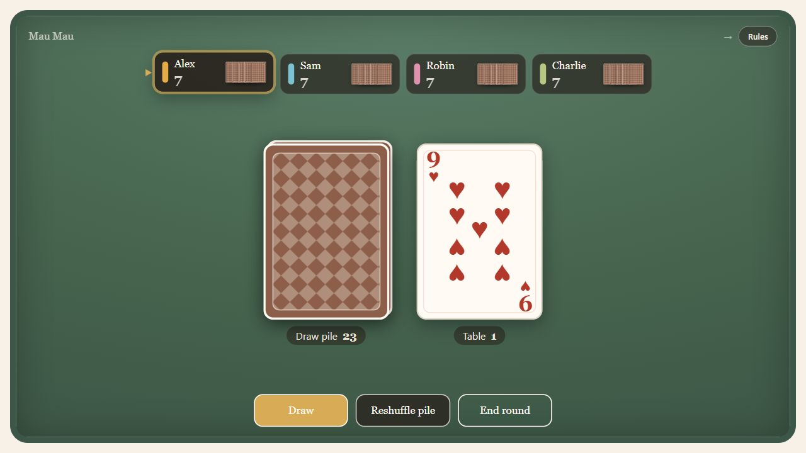
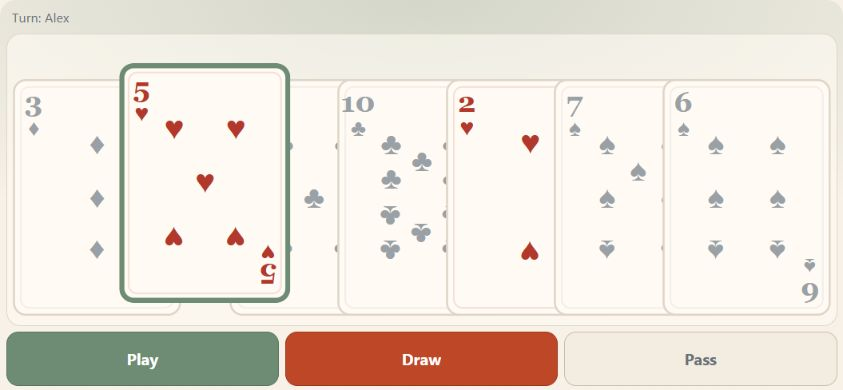
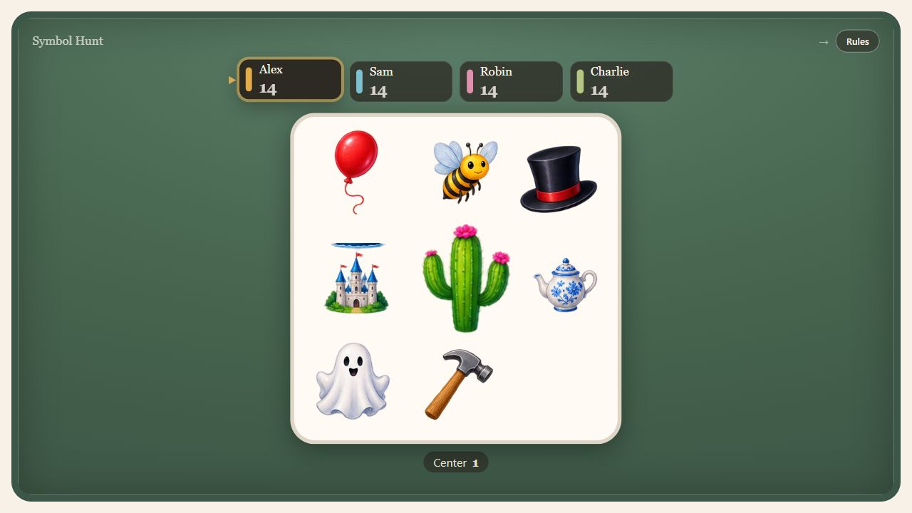

# Card Table

Twelve card games for [Open Party Lab](https://github.com/Hartwich/Open-Party-Lab): a shared table on the big screen, a private hand on each phone, and interchangeable, server-authoritative rulesets.

**Status: alpha.** Rules, pacing, balance and presentation are still evolving. The in-game name is **Kartentisch** in German and **Card Table** in English.

## Screenshots

### Shared table — Mau Mau



### Private phone hand — landscape



### Symbol Hunt



These images show the actual host renderer and phone controller using example round states. See [screenshot notes](docs/screenshots/README.md) for capture scope and dimensions.

## Included games

| Ruleset | How it plays | What it demonstrates |
| --- | --- | --- |
| **Mau Mau** | Match suit or rank. Sevens draw two, eights skip, nines reverse and jacks choose a suit, with configurable house rules. | Discard piles, draw penalties and choices before playing. |
| **Schwimmen (31)** | Three hand cards and three face-up table cards. Swap one or all, pass or knock; three lives, with 31 as the strongest hand. | Shared cards, swap targets and hand evaluation. |
| **Trick Bets (Stichwette)** | Bid your trick count, then play. Crowns beat everything; Feathers lose. Each round adds a card until a full deal. | Bidding, tricks, rotating dealers and series scoring. |
| **Number Rows (Zahlenreihe)** | Build four color rows from 1 to 20, each opened by an eleven. Play as many matching cards as you want in a turn. | Multiple destinations and turns with several actions. |
| **Cheat (Lügen)** | Play face-down cards and announce their rank, truthfully or otherwise. Challenge a claim; the loser takes the pile. | Hidden piles, declarations and out-of-turn challenges. |
| **Old Maid (Schwarzer Peter)** | Discard pairs and draw blindly from a neighbor. The player left with the unpaired card loses. | Automatic pair removal and blind draws. |
| **Go Fish (Fischen)** | Ask another player for a rank. Collect four of a kind; otherwise draw from the stock. | Player selection, requests and completed sets. |
| **Hearts (Herzeln)** | Avoid hearts and the queen of spades. Follow suit, break hearts before leading them, or collect all penalty cards to reverse the score. | Following suit, negative scores and round-wide conditions. |
| **Rummy (Rommé)** | Two 52-card packs and four jokers. Open with 40 points, build sets and runs, extend melds and discard to finish a turn. | Meld validation, shared layouts and cumulative scores. |
| **Symbol Hunt (Symboljagd)** | Find the one shared picture between your top card and the center card. Play solo against the clock or race other players. | Real-time matching, illustrated symbols and timed solo results. |
| **Doppelkopf** | Each card appears twice. Diamonds, queens, jacks and heart tens are trumps; club queens form Re against Kontra. | Hidden teams, trump ordering, reservations, announcements and house rules. |
| **Free Play** | An open table without enforced card rules: draw, discard and advance the turn manually. | A minimal template for new rulesets. |

Each ruleset supplies full rules in **German and English**. Open **Rules** on the host to read the goal, turn sequence, legal moves, special cards and scoring. Active rules reflect the selected house rules.

## Host, phone and server

The **host** shows the shared table: stock, discard, tricks, exposed cards, rows, seats, hand counts and ruleset actions. The active seat is highlighted. Its compact header shows the game, direction and active conditions such as a wished suit or draw penalty. The table is a DOM overlay over the Phaser stage.

The **phone** shows a private hand, actions, turn information and private hints. Tap a card to select it, then tap again or use **Play**. Shared piles stay on the host. Play, Draw and other standard hand actions use equal widths.

The **server** decides move legality, timers, scoring and round transitions. Controllers send intent; neither the host nor the phone decides game outcomes.

## Setup

Settings appear only when they apply to the selected ruleset.

| Setting | Availability and behavior |
| --- | --- |
| Ruleset and deck | Twelve games; deck selection only where the game permits it. |
| Initial hand size | 3–12 cards for Mau Mau, Cheat, Go Fish and Free Play. Other games control their own deals. |
| Sort hand | Doppelkopf, Hearts, Trick Bets and Rummy. |
| Dim unplayable cards | Enabled by default. Turning it off changes visual help, not legality. |
| AI players | 0–5 requested AI seats, within the selected game's seat limit. |
| Card style | Classic, Modern or Clear. |
| Doppelkopf house rules | Nines, second heart ten, bonus scoring and other setup rules; eyes can be counted during play or only at the end. |
| Mau Mau house rules | Stack sevens, skip on eights, reverse on nines, jack on jack, and immediately play a normally drawn card. These preserve the original enabled defaults. |
| Play after a penalty draw | Mau Mau only; disabled by default and independent of normal drawing. |
| Symbol Hunt symbols | 8, 9 or 10 symbols per card. |
| Symbol Hunt workload | Whole deck, or an equal fixed target of 1–300 cards per player; the fixed target defaults to 30. |

With **Play after a penalty draw** enabled, a player who takes a +2, stacked +4, +6 or larger penalty may play **one matching card from those just drawn**, or keep them all and pass. Older hand cards cannot be played in that turn. If none of the drawn cards fits, the turn advances automatically. When disabled, taking penalty cards always ends the turn. The option for immediately playing a normally drawn single card is separate.

Symbol Hunt's 8-, 9- and 10-symbol sets contain 57, 73 and 91 distinct pictures and guarantee exactly one common symbol between each pair of cards. Fixed workloads give every player the same target and recycle old center cards when needed. A single human can play without AI. Solo time is measured on the server and frozen in the result: pauses do not count, wrong-answer lockouts do. Multiplayer uses a five-second wrong-answer lockout and a two-second grace period for nearly simultaneous correct matches.

## AI players

**One human is enough to start.** Rulesets declare a minimum seat count: Mau Mau needs two, Hearts three and Doppelkopf four. Missing seats are filled with AI automatically. The requested AI count can add seats above that minimum, within the game's player limit; humans take priority.

AI seats have their own color, hand and game scores, with a turn delay of about 1.2 seconds. The driver asks the ruleset for an intent and submits it through the same play, draw or action functions used by humans.

Tactics include saving Mau Mau wild cards, evaluating Schwimmen swaps, managing bids and trick targets, extending Number Rows, choosing Go Fish requests, and avoiding costly Hearts tricks. Rulesets without custom tactics use the generic legal-move fallback. Bots must not inspect opponents' hidden hands or teams; Doppelkopf bots do not have perfect partner knowledge. AI scores appear in Card Table results, not as players in the platform-wide leaderboard.

## Installation

This is an optional Open Party Lab game package, not a standalone app. Install the platform's dependencies first, then run these commands in its checkout:

```bash
git clone https://github.com/Hartwich/card-table.git local-games/card-table
npm install --prefix local-games/card-table
npm run games:sync-local
npm run dev:all
```

Sync builds and links installed game packages and generates platform registries. Do not add static imports for optional games.

## Development

Inside this game repository:

```bash
npm install
npm run typecheck
npm run build
npm test
npm run pack:dry-run
```

After changes, run `npm run games:sync-local` and `npm run typecheck` in the platform checkout.

| Component | Location |
| --- | --- |
| Deck definitions | `src/cards/deckPresets.ts` |
| Table engine: piles, hands, zones and turns | `src/cards/cardTable.ts` |
| SVG card faces and styles | `src/cards/cardSvg.ts` |
| Ruleset contract and implementations | `src/rules/types.ts`, `src/rules/*.ts` |
| Ruleset registry | `src/rules/index.ts` |
| Authoritative runtime | `src/server/index.ts` |
| Host integration and table markup | `src/host/index.ts`, `src/host/tableHtml.ts` |
| Host cards and round screens | `src/host/cardHtml.ts`, `src/host/roundScreens.ts` |
| Controller model | `src/controller/index.ts` |
| AI seats, driver, fallback and tactics | `src/bots/` |
| Game protocol | `src/protocol.ts` |

The reusable `card_hand` layout belongs to the platform at `apps/controller/src/controller-ui/layouts/CardHandLayout.tsx`. Reuse it before adding another layout. Keep this game's protocol synchronized with the platform's `packages/protocol/src/games/cardTable.ts`.

### Add a ruleset

1. Implement `CardRuleset` in `src/rules/<game>.ts`. `freePlay.ts` is the smallest example; `mauMau.ts` demonstrates special cards and choices.
2. Register it in `src/rules/index.ts` and add its selection in `src/manifest.ts`.
3. Supply German and English rules, seat limits and applicable setup fields.
4. Run typecheck, build and relevant rule tests, then sync the platform.

Use existing hooks for fixed or allowed decks, hand size, round setup, custom stacks, choices, private notes, conditions, seat status and AI tactics. Settings are passed as `context.settings`; setup fields use `visibleWhen` to hide ineffective options.

Table zones can represent tricks, melds, hidden piles or rows. A `pile` shows at most three overlapping cards; a `spread` shows all cards in model order. Completed tricks remain visible until the next trick is complete, then move to an archive zone. Scoring is separate from visual card locations.

## Rounds and scoring

Human players use **Ready** on their phones after a result. Once all humans are ready, the next round starts; AI seats do not wait for confirmation. Scores carry across rounds of the same ruleset, separately from general room scores. **Main menu** ends the series and returns to game selection.

**Trick Bets** uses an original four-suit deck, ranks 1–13, four Crowns and four Feathers. Dealer and starting player rotate. A revealed Crown requires the dealer to choose trump before bidding. The series grows from one card to a full deal; a fresh series resets its hand size and scores.

**Number Rows** deals 20/20/15/12/10 cards for 2/3/4/5/6 players. It opens with the first available eleven in red/yellow/green/blue priority and draws at most three cards individually when no move is available. Remaining hand values count negatively.

**Rummy** uses two French packs and four jokers: 108 cards. Players receive 13 cards; the first gets 14 and opens the discard pile. Opening requires 40 points in valid sets or runs. Aces may be low or high; runs do not wrap. After opening, players may add or extend melds and exchange a joker for the exact card it represents. A returned joker cannot be discarded. Emptying the hand earns 40 points plus opponents' deadwood; opponents lose their remaining values. Exhausted piles resolve by lowest deadwood without a bonus, with ties sharing the result.

## Known limitations

- All games are alpha; physical-phone and sustained multiplayer usability still need validation.
- Mau Mau does not enforce a spoken “Mau” announcement; it displays the one-card status.
- Schwimmen does not rotate the dealer; the first seat starts.
- Hearts does not pass cards before a round.
- The host table is designed for landscape and becomes crowded below roughly 1000 pixels wide.
- AI delay is fixed rather than configurable, and tactics are heuristic. Doppelkopf bots may take a partner's trick.
- Piles display at most three face-up cards; use a spread when every card must be visible.

## License and artwork

This repository is licensed under the **Apache License 2.0**, matching the package's `Apache-2.0` metadata. See [LICENSE](LICENSE) for the full text. Dependencies retain their respective licenses.

The game includes programmatically drawn SVG cards and original raster illustrations for Trick Bets and Symbol Hunt. Runtime images are under `public/host/card-table/` and `public/controller/card-table/`; additional source artwork is under `assets/`. The README screenshots show these actual renderers and assets. Do not add artwork with unclear usage rights.
